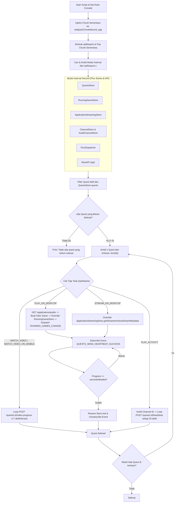
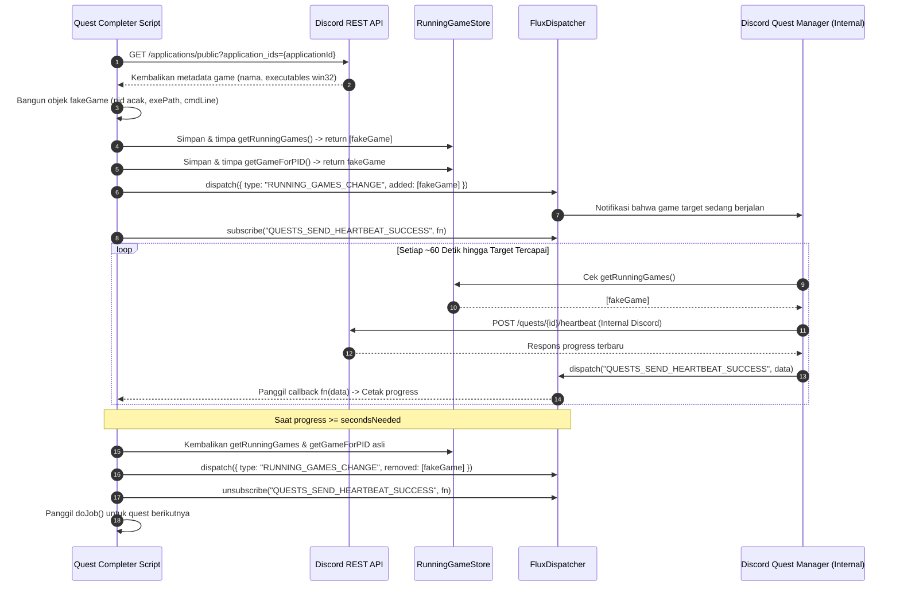

# 🎮 Discord Quest Auto Completer

Script otomatisasi berbasis **DevTools Console** untuk menyelesaikan berbagai **Discord Quests** (menonton video, bermain game di desktop, melakukan streaming di Voice Channel, maupun memainkan Discord Activity) secara otomatis tanpa perlu mengunduh atau menjalankan game aslinya.

---

## ✨ Fitur Utama

- **Multi-Task Support:** Mendukung 5 tipe objektif Discord Quest sekaligus:
  - `WATCH_VIDEO` — Menyelesaikan quest menonton video promosi (dipercepat ~7x).
  - `WATCH_VIDEO_ON_MOBILE` — Menyelesaikan quest video khusus mobile langsung dari Desktop/Browser.
  - `PLAY_ON_DESKTOP` — Melakukan *spoofing* proses game di `RunningGameStore` tanpa perlu menginstal game.
  - `STREAM_ON_DESKTOP` — Melakukan *spoofing* metadata share screen di `ApplicationStreamingStore`.
  - `PLAY_ACTIVITY` — Mengirimkan *heartbeat* otomatis untuk quest berbasis Discord Embedded Activity.
- **Queue Processing (`doJob`):** Memproses seluruh quest yang sudah di-*accept* secara berurutan hingga tuntas.
- **Auto Cleanup:** Mengembalikan fungsi internal `RunningGameStore` dan `ApplicationStreamingStore` ke kondisi semula segera setelah quest selesai.
- **Kompatibel dengan Update Webpack Discord Terbaru:** Menggunakan selektor modul `exports.A` / `exports.Ay` / `exports.h` / `exports.Bo` yang presisi sehingga tidak bentrok dengan *i18n Locale Proxy* milik Discord.

---

## 🚀 Cara Penggunaan

### 1. Persiapan
1. Gunakan **Aplikasi Discord Desktop** (wajib untuk quest bertipe *Play Game* atau *Stream Game*).
2. Buka menu **User Settings > Gift Inventory / Quests** atau tab **Discover > Quests**.
3. Klik tombol **Accept Quest** (atau pilih platform **PC/Desktop** terlebih dahulu) pada quest yang ingin diselesaikan.
   - *Catatan:* Untuk quest video, klik tombol **Watch** sekali agar status quest berubah menjadi aktif (*enrolled*).

### 2. Membuka DevTools Console di Discord Desktop
Tekan kombinasi tombol **`Ctrl + Shift + I`** di aplikasi Discord Desktop, lalu pilih tab **Console**.

> **💡 Tips jika `Ctrl + Shift + I` tidak bisa dibuka di Discord Stable:**
> 1. Tutup Discord sepenuhnya.
> 2. Buka file `%appdata%\discord\settings.json` menggunakan Notepad/VS Code.
> 3. Tambahkan `"DANGEROUS_ENABLE_DEVTOOLS_ONLY_ENABLE_IF_YOU_KNOW_WHAT_YOURE_DOING": true` di dalam objek JSON:
>    ```json
>    {
>      "IS_MAXIMIZED": true,
>      "IS_MINIMIZED": false,
>      "DANGEROUS_ENABLE_DEVTOOLS_ONLY_ENABLE_IF_YOU_KNOW_WHAT_YOURE_DOING": true
>    }
>    ```
> 4. Simpan file dan buka kembali Discord.

### 3. Menjalankan Script
1. Di tab **Console**, jika Discord meminta konfirmasi keamanan sebelum menempel kode, ketik `allow pasting` lalu tekan **Enter**.
2. Salin seluruh kode dari [`quest_completer.js`](./quest_completer.js) (atau dari blok kode di bawah) ke Console, lalu tekan **Enter**.
3. Pantau progres yang muncul di Console (`Quest progress: xxx/900`) hingga muncul pesan `Quest completed!`, lalu klaim hadiahmu di tab **Quests**.

---

## 💻 Kode Script (Copy & Paste)

```javascript
delete window.$;
let wpRequire = webpackChunkdiscord_app.push([[Symbol()], {}, r => r]);
webpackChunkdiscord_app.pop();

let ApplicationStreamingStore = Object.values(wpRequire.c).find(x => x?.exports?.A?.__proto__?.getStreamerActiveStreamMetadata).exports.A;
let RunningGameStore = Object.values(wpRequire.c).find(x => x?.exports?.Ay?.getRunningGames).exports.Ay;
let QuestsStore = Object.values(wpRequire.c).find(x => x?.exports?.A?.__proto__?.getQuest).exports.A;
let ChannelStore = Object.values(wpRequire.c).find(x => x?.exports?.A?.__proto__?.getAllThreadsForParent).exports.A;
let GuildChannelStore = Object.values(wpRequire.c).find(x => x?.exports?.A?.__proto__?.getSFWDefaultChannel).exports.A;
let FluxDispatcher = Object.values(wpRequire.c).find(x => x?.exports?.h?.__proto__?.flushWaitQueue).exports.h;
let api = Object.values(wpRequire.c).find(x => x?.exports?.Bo?.get).exports.Bo;

const supportedTasks = ["WATCH_VIDEO", "PLAY_ON_DESKTOP", "STREAM_ON_DESKTOP", "PLAY_ACTIVITY", "WATCH_VIDEO_ON_MOBILE"]
let quests = [...QuestsStore.quests.values()].filter(x => x.userStatus?.enrolledAt && !x.userStatus?.completedAt && new Date(x.config.expiresAt).getTime() > Date.now() && supportedTasks.find(y => Object.keys((x.config.taskConfig ?? x.config.taskConfigV2).tasks).includes(y)))
let isApp = typeof DiscordNative !== "undefined"
if(quests.length === 0) {
	console.log("You don't have any uncompleted quests!")
} else {
	let doJob = function() {
		const quest = quests.pop()
		if(!quest) return

		const pid = Math.floor(Math.random() * 30000) + 1000
		
		const questName = quest.config.messages.questName
		const taskConfig = quest.config.taskConfig ?? quest.config.taskConfigV2
		const taskName = supportedTasks.find(x => taskConfig.tasks[x] != null)
		const taskData = taskConfig.tasks[taskName]
		const applicationId = quest.config.application?.id ?? taskData.applications?.[0]?.id
		const secondsNeeded = taskData.target
		let secondsDone = quest.userStatus?.progress?.[taskName]?.value ?? 0

		if(taskName === "WATCH_VIDEO" || taskName === "WATCH_VIDEO_ON_MOBILE") {
			const speed = 7
			const enrolledAt = new Date(quest.userStatus.enrolledAt).getTime()
			let completed = false
			let fn = async () => {			
				while(true) {
					const remaining = Math.min(speed, secondsNeeded - secondsDone)
					await new Promise(resolve => setTimeout(resolve, remaining * 1000))

					const timestamp = secondsDone + speed
					const res = await api.post({url: `/quests/${quest.id}/video-progress`, body: {timestamp: Math.min(secondsNeeded, timestamp + Math.random())}})
					completed = res.body.completed_at != null
					secondsDone = Math.min(secondsNeeded, timestamp)

					if(timestamp >= secondsNeeded) {
						break
					}
				}
				if(!completed) {
					await api.post({url: `/quests/${quest.id}/video-progress`, body: {timestamp: secondsNeeded}})
				}
				console.log("Quest completed!")
				doJob()
			}
			fn()
			console.log(`Spoofing video for ${questName}.`)
		} else if(taskName === "PLAY_ON_DESKTOP") {
			if(!isApp) {
				console.log("This no longer works in browser for non-video quests. Use the discord desktop app to complete the", questName, "quest!")
			} else {
				api.get({url: `/applications/public?application_ids=${applicationId}`}).then(res => {
					const appData = res.body[0]
					const exeName = appData.executables?.find(x => x.os === "win32")?.name?.replace(">","") ?? appData.name.replace(/[\/\\:*?"<>|]/g, "")
					
					const fakeGame = {
						cmdLine: `C:\\Program Files\\${appData.name}\\${exeName}`,
						exeName,
						exePath: `c:/program files/${appData.name.toLowerCase()}/${exeName}`,
						hidden: false,
						isLauncher: false,
						id: applicationId,
						name: appData.name,
						pid: pid,
						pidPath: [pid],
						processName: appData.name,
						start: Date.now(),
					}
					const realGames = RunningGameStore.getRunningGames()
					const fakeGames = [fakeGame]
					const realGetRunningGames = RunningGameStore.getRunningGames
					const realGetGameForPID = RunningGameStore.getGameForPID
					RunningGameStore.getRunningGames = () => fakeGames
					RunningGameStore.getGameForPID = (pid) => fakeGames.find(x => x.pid === pid)
					FluxDispatcher.dispatch({type: "RUNNING_GAMES_CHANGE", removed: realGames, added: [fakeGame], games: fakeGames})
					
					let fn = data => {
						let progress = quest.config.configVersion === 1 ? data.userStatus.streamProgressSeconds : Math.floor(data.userStatus.progress.PLAY_ON_DESKTOP.value)
						console.log(`Quest progress: ${progress}/${secondsNeeded}`)
						
						if(progress >= secondsNeeded) {
							console.log("Quest completed!")
							
							RunningGameStore.getRunningGames = realGetRunningGames
							RunningGameStore.getGameForPID = realGetGameForPID
							FluxDispatcher.dispatch({type: "RUNNING_GAMES_CHANGE", removed: [fakeGame], added: [], games: []})
							FluxDispatcher.unsubscribe("QUESTS_SEND_HEARTBEAT_SUCCESS", fn)
							
							doJob()
						}
					}
					FluxDispatcher.subscribe("QUESTS_SEND_HEARTBEAT_SUCCESS", fn)
					
					console.log(`Spoofed your game to ${appData.name}. Wait for ${Math.ceil((secondsNeeded - secondsDone) / 60)} more minutes.`)
				})
			}
		} else if(taskName === "STREAM_ON_DESKTOP") {
			if(!isApp) {
				console.log("This no longer works in browser for non-video quests. Use the discord desktop app to complete the", questName, "quest!")
			} else {
				let realFunc = ApplicationStreamingStore.getStreamerActiveStreamMetadata
				ApplicationStreamingStore.getStreamerActiveStreamMetadata = () => ({
					id: applicationId,
					pid,
					sourceName: null
				})
				
				let fn = data => {
					let progress = quest.config.configVersion === 1 ? data.userStatus.streamProgressSeconds : Math.floor(data.userStatus.progress.STREAM_ON_DESKTOP.value)
					console.log(`Quest progress: ${progress}/${secondsNeeded}`)
					
					if(progress >= secondsNeeded) {
						console.log("Quest completed!")
						
						ApplicationStreamingStore.getStreamerActiveStreamMetadata = realFunc
						FluxDispatcher.unsubscribe("QUESTS_SEND_HEARTBEAT_SUCCESS", fn)
						
						doJob()
					}
				}
				FluxDispatcher.subscribe("QUESTS_SEND_HEARTBEAT_SUCCESS", fn)
				
				console.log(`Spoofed your stream to the target game. Stream any window in vc for ${Math.ceil((secondsNeeded - secondsDone) / 60)} more minutes.`)
				console.log("Remember that you need at least 1 other person to be in the vc!")
			}
		} else if(taskName === "PLAY_ACTIVITY") {
			const channelId = ChannelStore.getSortedPrivateChannels()[0]?.id ?? Object.values(GuildChannelStore.getAllGuilds()).find(x => x != null && x.VOCAL.length > 0).VOCAL[0].channel.id
			const streamKey = `call:${channelId}:1`
			
			let fn = async () => {
				console.log("Completing quest", questName, "-", quest.config.messages.questName)
				
				while(true) {
					const res = await api.post({url: `/quests/${quest.id}/heartbeat`, body: {stream_key: streamKey, terminal: false}})
					const progress = res.body.progress.PLAY_ACTIVITY.value
					console.log(`Quest progress: ${progress}/${secondsNeeded}`)
					
					await new Promise(resolve => setTimeout(resolve, 20 * 1000))
					
					if(progress >= secondsNeeded) {
						await api.post({url: `/quests/${quest.id}/heartbeat`, body: {stream_key: streamKey, terminal: true}})
						break
					}
				}
				
				console.log("Quest completed!")
				doJob()
			}
			fn()
		}
	}
	doJob()
}
```

---

## 🏗️ Arsitektur & Alur Kerja Sistem

### 1. Diagram Alur Utama (High-Level Architecture)

Diagram berikut menjelaskan bagaimana script menginjeksi Webpack chunk Discord, mengekstrak store internal, menyaring quest aktif, dan memilih strategi penyelesaian berdasarkan jenis task:



---

### 2. Sequence Diagram: Mekanisme Spoofing `PLAY_ON_DESKTOP`

Untuk quest bertipe `PLAY_ON_DESKTOP`, kita tidak memanggil endpoint heartbeat secara manual, melainkan memanipulasi `RunningGameStore` dan `FluxDispatcher` sehingga sistem internal Discord sendiri yang mengirimkan *heartbeat* resmi ke server Discord:



---

## 🔍 Bedah Kode Secara Detail

### 1. Membajak Webpack Chunk Loader (`wpRequire`)
```javascript
delete window.$;
let wpRequire = webpackChunkdiscord_app.push([[Symbol()], {}, r => r]);
webpackChunkdiscord_app.pop();
```
- **`delete window.$`**: Menghapus *getter* bawaan Chrome DevTools (`window.$`) agar tidak mengganggu eksekusi global.
- **`webpackChunkdiscord_app.push(...)`**: Aplikasi frontend Discord dibundel menggunakan **Webpack**. Objek global `webpackChunkdiscord_app` menerima array chunk baru dengan format `[chunkIds, moreModules, runtimeCallback]`. Dengan mengirimkan fungsi callback `r => r` pada parameter ketiga, Webpack secara otomatis menyerahkan fungsi internal `__webpack_require__` (`r`) ke variabel `wpRequire`.
- **`webpackChunkdiscord_app.pop()`**: Menghapus kembali chunk dummy yang baru saja kita masukkan agar array chunk tetap bersih.

---

### 2. Mengekstrak Store & Modul Internal dari Cache (`wpRequire.c`)
```javascript
let ApplicationStreamingStore = Object.values(wpRequire.c).find(x => x?.exports?.A?.__proto__?.getStreamerActiveStreamMetadata).exports.A;
let RunningGameStore = Object.values(wpRequire.c).find(x => x?.exports?.Ay?.getRunningGames).exports.Ay;
let QuestsStore = Object.values(wpRequire.c).find(x => x?.exports?.A?.__proto__?.getQuest).exports.A;
let ChannelStore = Object.values(wpRequire.c).find(x => x?.exports?.A?.__proto__?.getAllThreadsForParent).exports.A;
let GuildChannelStore = Object.values(wpRequire.c).find(x => x?.exports?.A?.__proto__?.getSFWDefaultChannel).exports.A;
let FluxDispatcher = Object.values(wpRequire.c).find(x => x?.exports?.h?.__proto__?.flushWaitQueue).exports.h;
let api = Object.values(wpRequire.c).find(x => x?.exports?.Bo?.get).exports.Bo;
```
`wpRequire.c` adalah objek cache yang menyimpan ribuan modul internal Discord yang sudah dimuat. Karena nama modul telah di-*minify* oleh Webpack (menjadi properti singkat seperti `A`, `Ay`, `h`, `Bo`), kita mencari modul berdasarkan **signature metode unik** yang dimilikinya:

| Variabel | Fungsi di Dalam Discord | Signature Metode Unik |
| :--- | :--- | :--- |
| `ApplicationStreamingStore` | Menyimpan status dan metadata Go Live / Share Screen pengguna. | `exports.A.__proto__.getStreamerActiveStreamMetadata` |
| `RunningGameStore` | Mendeteksi daftar proses aplikasi/game yang sedang berjalan di PC. | `exports.Ay.getRunningGames` |
| `QuestsStore` | Menyimpan seluruh daftar quest, konfigurasi target durasi, dan progres user. | `exports.A.__proto__.getQuest` |
| `ChannelStore` | Mengambil daftar channel DM/grup untuk keperluan stream key Activity. | `exports.A.__proto__.getAllThreadsForParent` |
| `GuildChannelStore` | Mengambil daftar voice channel server jika user tidak memiliki private channel. | `exports.A.__proto__.getSFWDefaultChannel` |
| `FluxDispatcher` | Event bus utama arsitektur Flux Discord untuk mengirim (`dispatch`) & mendengarkan (`subscribe`) event. | `exports.h.__proto__.flushWaitQueue` |
| `api` | Klien HTTP internal Discord (otomatis menyertakan token autentikasi & header resmi). | `exports.Bo.get` |

> **⚠️ Mengapa harus mengecek properti spesifik (`exports.A` / `exports.Ay`)?**
> Discord memiliki modul translasi bahasa (`IntlMessageProxy`) yang menggunakan JavaScript `Proxy`. Jika sebuah script mencari modul secara sembarangan tanpa memvalidasi struktur export/prototipenya, `Proxy` bahasa tersebut akan merespons positif terhadap properti apa pun dan menyebabkan error `Requested message ... does not have a value in the requested locale`.

---

### 3. Menyaring Quest yang Valid
```javascript
const supportedTasks = ["WATCH_VIDEO", "PLAY_ON_DESKTOP", "STREAM_ON_DESKTOP", "PLAY_ACTIVITY", "WATCH_VIDEO_ON_MOBILE"]
let quests = [...QuestsStore.quests.values()].filter(x =>
    x.userStatus?.enrolledAt &&
    !x.userStatus?.completedAt &&
    new Date(x.config.expiresAt).getTime() > Date.now() &&
    supportedTasks.find(y => Object.keys((x.config.taskConfig ?? x.config.taskConfigV2).tasks).includes(y))
)
```
Bagian ini mengambil semua quest dari `QuestsStore.quests` lalu menyaring hanya quest yang memenuhi **4 syarat**:
1. `x.userStatus?.enrolledAt`: Pengguna **sudah menekan tombol Accept/Start Quest**.
2. `!x.userStatus?.completedAt`: Quest **belum selesai**.
3. `new Date(x.config.expiresAt).getTime() > Date.now()`: Masa aktif quest **belum habis/expired**.
4. Memiliki salah satu tipe task di dalam `taskConfig` atau `taskConfigV2` yang termasuk dalam `supportedTasks`.

---

### 4. Mekanisme Penyelesaian Berdasarkan Tipe Task

#### A. `WATCH_VIDEO` & `WATCH_VIDEO_ON_MOBILE`
- Server Discord mengizinkan pelaporan progres video sedikit lebih cepat dari waktu nyata.
- Script melakukan perulangan (`while(true)`), menunggu beberapa detik, lalu mengirim `POST /quests/${quest.id}/video-progress` dengan nilai `timestamp` yang dinaikkan sebesar `speed = 7` detik ditambah angka desimal acak (`Math.random()`) agar menyerupai pemutaran video asli.
- Begitu `timestamp >= secondsNeeded`, script mengirimkan laporan terakhir pada angka `secondsNeeded` untuk memastikan status `completed_at` terisi.

#### B. `PLAY_ON_DESKTOP`
- Hanya berjalan di aplikasi **Discord Desktop** (`typeof DiscordNative !== "undefined"`).
- Mengambil informasi game dari `/applications/public?application_ids=${applicationId}` untuk mendapatkan nama file `.exe` resmi Windows (`win32`) yang dikenali Discord.
- Membuat objek `fakeGame` lengkap dengan `cmdLine`, `exeName`, `exePath`, dan `pid` acak.
- Melakukan **monkey-patching** pada `RunningGameStore.getRunningGames` dan `RunningGameStore.getGameForPID` agar mengembalikan `[fakeGame]`.
- Mengirim event `FluxDispatcher.dispatch({ type: "RUNNING_GAMES_CHANGE", ... })`. Hal ini memicu modul internal Discord untuk mulai mengirimkan *heartbeat* resmi ke server setiap menit.
- Script memantau event `QUESTS_SEND_HEARTBEAT_SUCCESS` hingga progres mencapai `secondsNeeded`, lalu mengembalikan fungsi asli `RunningGameStore`.

#### C. `STREAM_ON_DESKTOP`
- Melakukan **monkey-patching** pada `ApplicationStreamingStore.getStreamerActiveStreamMetadata` sehingga setiap kali kamu melakukan Share Screen jendela apa saja di Voice Channel (bersama minimal 1 orang lain), Discord menganggap kamu sedang men-stream game target (`applicationId`).
- Memantau event `QUESTS_SEND_HEARTBEAT_SUCCESS` hingga selesai, lalu mengembalikan fungsi asli.

#### D. `PLAY_ACTIVITY`
- Mengambil ID channel DM pertama atau Voice Channel pertama dari server yang kamu ikuti untuk membentuk `streamKey` dengan format `call:${channelId}:1`.
- Mengirimkan request `POST /quests/${quest.id}/heartbeat` dengan `{ stream_key: streamKey, terminal: false }` setiap **20 detik**.
- Saat progres mencapai `secondsNeeded`, script mengirim satu request penutup dengan `terminal: true`.

---

## 🛠️ Troubleshooting

| Masalah / Pesan di Console | Penyebab & Solusi |
| :--- | :--- |
| `"You don't have any uncompleted quests!"` | Kamu belum menekan tombol **Accept Quest** (atau memilih platform) di halaman Quests Discord. Klik **Accept Quest** terlebih dahulu lalu jalankan ulang script. |
| `"This no longer works in browser for non-video quests..."` | Quest bertipe `PLAY_ON_DESKTOP` dan `STREAM_ON_DESKTOP` membutuhkan modul native desktop. Gunakan aplikasi **Discord Desktop**, bukan browser atau klien wrapper berbasis web (seperti Vesktop). |
| Tidak bisa melakukan Paste di Console | Ketik `allow pasting` secara manual di Console lalu tekan **Enter**, kemudian tempelkan kembali script-nya. |
| Hanya muncul `undefined` dan pesan chat menjadi macet | Bug bawaan Electron/DevTools Discord saat baru dibuka. Tekan `Ctrl + R` untuk memuat ulang Discord lalu coba lagi. |

---

## 📜 Lisensi & Kredit

- Kredit script asli: [aamiaa](https://gist.github.com/aamiaa/204cd9d42013ded9faf646fae7f89fbb)
- Dilisensikan di bawah **GNU General Public License v3.0 (GPL-3.0)**.
